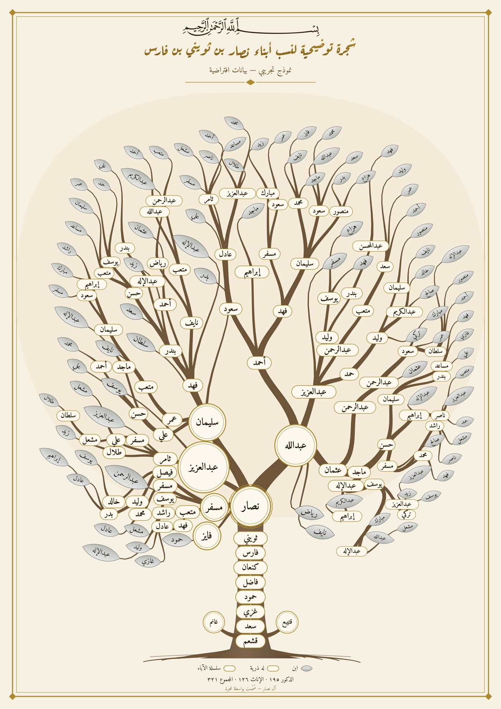
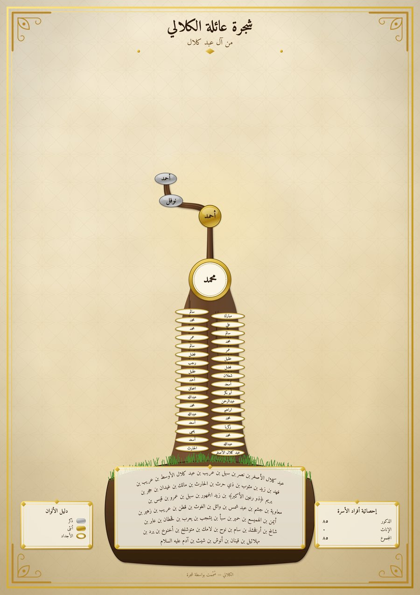
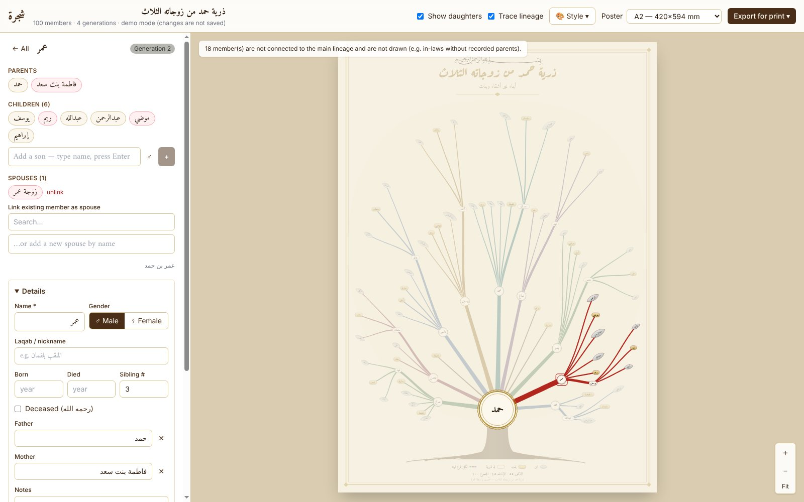

# شجرة · Shajarah — Family Tree Poster Generator

Enter a family (parents, children, spouses) and Shajarah grows it into an
ornamental, botanical nasab poster: the ancestral chain on the trunk, the
sons of the first branching ancestor as main limbs, and curved tapered
branches. **Every leaf is a person** with their name written on it:
satin-silver leaves for sons, soft-gold capsules for daughters. Members
with descendants are ivory capsules with a gold rim at their branch forks.
You can export it as vector SVG, a high-DPI PDF/PNG, or a tiled PDF for
printing on smaller sheets.

The genealogy is the primary element. The layout sizes itself from the
family, keeps every name legible at the chosen poster size, and says so
when a family needs a larger poster.

| Generated poster (demo data) | Al-Kalali lineage: foundation, trunk, canopy | Editor |
| --- | --- | --- |
|  |  |  |

## Stack

- **Next.js 14** (App Router, TypeScript) + **Tailwind CSS**
- **SVG** rendering, **d3-hierarchy** for the tree model, **d3-zoom** for pan/zoom
- **Prisma 5** + **PostgreSQL** for relational family data
- **jsPDF** for print PDF export · **Vitest** for layout tests

## Getting started

```bash
cd shajarah
npm install                    # also copies the Amiri fonts and generates the Prisma client
docker compose up -d           # PostgreSQL 16 on localhost:5432 (or use your own server)
cp .env.example .env           # adjust DATABASE_URL if needed
npm run db:migrate             # applies prisma/migrations
npm run db:seed                # optional: a 321-member sample family + the Al-Kalali lineage
npm run dev                    # http://localhost:3000
```

The page at **`/demo`** works without a database. It runs the same editor
with an in-memory repository. **`/demo?sample=kalali`** loads the Al-Kalali
lineage (85 generations, آدم → أحمد بن نوفل).

## Entering a family quickly: paste a nasab

Click **بن…** in the member list and paste one lineage per line, newest name
first:

```
أحمد بن نوفل بن أحمد بن محمد بن سالم … بن شيث بن آدم عليه السلام
فاطمة بنت نوفل بن أحمد بن محمد
```

- Each line becomes a chain of fathers. "بنت" marks the first person as a
  daughter. Text in parentheses, such as «يريم (ذو رعين الأكبر)», and
  honorifics like «عليه السلام» are stored as the laqab.
- Matching uses spelling-tolerant names (أ/إ/ا, ة/ه, «عبد الله»/«عبدالله»).
  People already in the tree are reused, and new ones are added below or
  above them. A line can start mid-tree. At least two consecutive names
  must agree before a line joins, so a lone «محمد» never links strangers.
- A preview shows how many names are reused and how many are new. It warns
  when a line fits in two places equally well.
- After an import, **Undo this import** in the member list removes exactly
  what it added (see below).

## Importing and exporting GEDCOM

Click **GEDCOM** in the member list. GEDCOM 5.5.1 (`.ged`) is the file every
genealogy program exports: Ancestry, MyHeritage, FamilySearch, Gramps,
MacFamilyTree and others.

- **Preview first.** The file is read and matched in the browser with the
  same planner the server runs. You see how many people are new, how many
  are already in the tree, the new marriages, members who gain a parent, the
  new start of the trunk, and anything that could not be imported. Nothing is
  saved until you press Import.
- **The preview never freezes the editor.** Reading and matching run in a
  Web Worker; done on the page, they took 0.7 s for 19,000 people and 7.4 s
  for 150,000. With the worker, the page never waited more than 33 ms
  between frames while it read the 150,000-person file. A spinner shows
  while it works, and choosing another file abandons the one being read.
- **Limits:** one import takes up to 20 MB of text and 20,000 people. The
  preview says so and disables Import, before anything is sent. A file over
  40 MB is refused at once, without being read.
- **Matching** reuses the nasab importer's spelling-tolerant names. A person
  in the file is someone already in the tree when their names agree and their
  line agrees: their matched parent has exactly one child of that name, or, at
  the top of the file, the member has a child whose name agrees with one of
  theirs (two names in a row, so a lone «محمد» never joins strangers). A file
  that reaches further back than the tree adds the older ancestors above the
  root. Members in the tree are never changed, except that one without a
  recorded parent gets the parent from the file. A person who matches two
  places equally well is added as new and counted, so you can check for
  duplicates.
- **What is read:**
  - names (`NAME`/`GIVN`; a nasab written in the name is reduced to the
    person's own name when the file links their parents);
  - `NICK`/`NPFX`/`NSFX` and «(laqab)»/honorifics, which go to the laqab;
  - sex, and birth and death years from any GEDCOM date form (`ABT`,
    `BET … AND`, `1700/01`, calendar escapes);
  - death or burial, which marks a person deceased;
  - notes, including shared `NOTE` records and `CONC`/`CONT`;
  - places, exact dates and occupations, kept as lines in the notes;
  - parents (`FAMC`/`CHIL`, the first family when there are several);
    marriages and divorces;
  - birth order from the file's child order.
- **Encodings:** UTF-8 and UTF-16, with or without a byte-order mark. Older
  ANSEL files are read with a warning that accented letters may be wrong.
- **Sources and media are imported.**
  - Sources: `SOUR` records (`TITL`, or `ABBR` when there is no title;
    `AUTH`, `PUBL`, `NOTE`/`TEXT`), and sources written inline in a citation
    ("1 SOUR Parish register of …").
  - Citations: on a person or on one of their events (`1 BIRT` / `2 SOUR
    @S1@` / `3 PAGE p. 12`), with the event from `EVEN` or from the event
    the citation sits under.
  - Media: `OBJE` records, inline `OBJE` in 5.5 and 5.5.1 style, and the
    media of a source.
  - A marriage has no row of its own, so its citations go to both spouses
    (as `MARR`) and its media to the husband (or the wife).
  - A source with the same title and author as one already in the tree
    (spelling variants allowed) is reused. A citation or media link the tree
    already has is not repeated, so importing the same file twice creates
    nothing.
  - A GEDCOM file names its photos (`photos/ahmad.jpg`, `C:\Family\deed.pdf`)
    but does not contain them. The link is kept, and the person's panel offers
    "Upload it" to supply the file.
  - The preview says "Importing 3 sources, 6 citations and 4 media links".
    Citations of a source record missing from the file, and media links
    without a file, are skipped with a warning.
- **Bad data is reported, not imported:** a link that would make someone
  their own ancestor is left out, and so are two fathers on one child, each
  with a warning.
- **Import is one transaction.** People are inserted parents-first, one
  statement per generation (about 0.2 s for 320 people), and the result is
  the full tree.
- **An import is one undo step:** Ctrl/⌘+Z removes all of it, and redo brings
  it back. The **Undo this import** banner is a shortcut to the same step.
  If poster settings were changed after the import, the banner instead
  removes exactly what the import added, in one transaction: its members and
  marriages, any parent links it filled in, and the root it changed. That
  receipt is the difference between the tree before and after the import,
  so the banner also works for nasab imports. It is offered until the next
  change to the family.
- **Export:** "Download GEDCOM" (or `GET /api/trees/:treeId/gedcom`) writes a
  UTF-8 GEDCOM 5.5.1 file, which any genealogy program opens. Sibling order
  across several marriages, which GEDCOM's per-family child lists cannot
  express without dates, is kept in an `_SHAJARAH_ORDER` extension tag.
  Other programs ignore that tag.
  Exporting a family and importing it into an empty tree reproduces every
  person, link, marriage and sibling order (tested on all sample families).
  Importing it into the same tree reuses everyone and creates no one.

## Undo and redo

**↶ / ↷** in the header, or **Ctrl/⌘+Z** and **Ctrl/⌘+Shift+Z** (or
**Ctrl+Y**). The tooltip names the step: "Undo: Delete John", "Redo: Import
from family.ged".

- **Snapshots, not inverse operations.** Every edit already returns the whole
  tree, so the editor keeps the tree as it was before each edit, up to 50
  steps (`src/lib/history.ts`). There is no per-edit "undo" code to get
  wrong.
- **One step per edit.** Typing in the member form is one step when you
  press Save. Poster settings (style, sizes, "Show daughters") change on
  screen at once. They are saved 400 ms after the last change, and changes
  within 1.5 s of each other are one step: dragging a colour picker is one
  save and one undo. A GEDCOM or nasab import is one step.
- **The server always matches.** Undo shows the snapshot immediately and
  sends it to `POST /api/trees/:treeId/restore`.
  - The server checks the snapshot is a valid tree: no missing parent, no
    cycle, no person from another tree.
  - It writes only the difference, in one transaction (`src/lib/restore.ts`):
    rows that changed are updated, removed ones deleted, and missing ones
    re-created with the same ids, parents first.
  - So undoing a deletion brings back the same person, with their children's
    links and their marriages. Undoing one name change writes one row.
  - Undoing a 19,000-person import takes about 4 s.
  - If the server refuses, the editor goes back to where it was, history
    included.
- **Text fields keep their own undo.** In a text field, Ctrl/⌘+Z undoes your
  typing, not the tree.
- **History lasts for the session.** Reloading the page clears it, and the
  page shows what the server has.
- **Two tabs never overwrite each other** (see "Changes from two tabs"
  below). An undo in a tab that is out of date is refused, and that tab asks
  you to reload.
- **Sources, citations and photos are part of the snapshot.** Undoing the
  removal of a photo brings back the same file. Uploaded files are stored
  by content and never deleted with their link (see "Photos and documents").

## Changes from two tabs

Every tree has a version: the time of its last change. The editor sends
the version it last saw with every change, in the standard `If-Match`
header. On the server, each change runs in one transaction that:

1. locks the tree's row, so concurrent changes wait their turn;
2. compares versions, and on a mismatch writes nothing and answers `409
   Conflict` ("This family was changed in another tab…");
3. otherwise makes the change and moves the version on.

The editor then shows **"Another tab made changes to this family. Your last
change was not saved, so nothing was overwritten."** with a **Reload**
button. Optimistic changes (poster settings, an undo) are put back.

The editor sends its own changes one at a time, each with the version the
previous one returned, so a settings save racing an edit never conflicts
with itself. Requests without `If-Match` (scripts, `curl`) are not checked.
This is the groundwork for real collaboration, which can later merge
instead of refusing.

## Photos, documents and sources

Below a person's details:

- **Photos and documents:** upload JPEG, PNG, GIF, WebP or PDF (up to 5 MB).
  Images show as thumbnails, with an editable caption and a remove button.
- **Sources:** each citation shows the source, the page and the event. To
  cite one, pick a source, the event (birth, death, marriage, burial …) and
  the page. "＋ New source" opens a small dialog for the title, author,
  publication and notes.

Each change is saved at once and is one undo step; none of it waits for
the form's Save.

## The sources page

**Poster | Sources** in the header switches the main area to every source
of the family. `#sources` in the address keeps the view on reload.

- **The list** shows each source with how many citations, people and files
  it has; sources nobody cites are marked "not cited". Search covers title,
  author and publication, spelling-tolerant like the rest of the app. The
  list orders by title, most cited first, or unused first.
- **A source** has an edit form (title, author, publication, notes) and a
  table of everyone it is cited for, with the event and the page. A name
  opens that person in the side panel. The source's own scans and
  documents are listed too.
- **Duplicates** are pointed out: a source whose title (spelling variants
  and spacing aside) matches another's says "Looks like the same source
  as …" and offers it first as the merge target.
- **Merge** moves every citation and file to the source you keep. A citation
  of the same person, event and page, or the same file, that the kept source
  already has is dropped. The kept source keeps its own fields and takes the
  other's only where its own are empty; notes are joined. The confirmation
  names both sources with their authors and says what moves.
- **Delete** removes a source with its citations and file links; the people
  stay.

Every one of these is one undo step, guarded by the two-tab version check.
The merge is the same pure function on the server, in the demo and in the
tests (`src/lib/sources.ts`).

**Files** are uploaded to `POST /api/media/blob` and stored in the database
under their SHA-256 (`MediaBlob`). The Media row keeps only the URL
(`/api/media/blob/<sha256>`). This has three consequences:

- The tree, which travels with every edit and every undo snapshot, carries
  short URLs, not megabytes of base64.
- The same photo uploaded twice is stored once. A deleted photo's file stays
  stored, so undo can bring the photo back.
- Moving to cloud storage later changes only the URLs.

Files are served with `Cache-Control: immutable`, `nosniff` and a sandboxing
Content-Security-Policy. The server refuses `data:` and `javascript:` URLs
in Media rows. In the database-free demo there is no server, so an upload
is held in the page as a `data:` URL.

## The three tiers: foundation, trunk, canopy

The ancestral chain is split into three tiers. You set the two boundaries
on any member's panel:

| Tier | Who | Drawn as | Set with |
| --- | --- | --- | --- |
| **Foundation** (soil) | ancestors older than the trunk start (e.g. آدم … نصر) | one of five soil styles (below) | 🪵 **Start the trunk here** → `FamilyTree.trunkStartId` |
| **Trunk** | trunk start … the canopy's father (e.g. عبد كلال الأصغر … سالم) | ivory badges up the trunk, eldest at the bottom, joined by a gold thread | — |
| **Canopy** | the canopy base and all descendants | Bézier branches, leaves and capsules | 🌳 **Start the canopy here** → `FamilyTree.crownBaseId` |

- **Long trunks stay readable.** The trunk gets the height it needs: one
  row per ancestor at about the size of the names. When two staggered
  columns let every name print clearly larger (at least 25% larger), the
  trunk uses them, with the gold thread showing the order. The
  34-ancestor Al-Kalali trunk prints at about 8 mm on A2.
- **Automatic mode:** without a trunk start, up to 12 of the nearest
  ancestors go on the trunk (fewer if they would not fit legibly) and the
  rest into the foundation. Without a canopy base, the canopy starts at
  the first real fork.
- **Custom foundation text:** to inscribe a lineage exactly as a source
  writes it, paste it under **Style → Soil inscription**
  (`FamilyTree.soilText`).
- **Laqabs and honorifics** appear as a quiet second line under the name
  (الشيخ، رحمه الله …). In the foundation text they use the classical ornate
  brackets «يريم ﴿ذو رعين الأكبر﴾».
- **Side branches:** brothers of trunk ancestors grow as side branches with
  their own small canopy. Brothers without descendants become small
  medallions beside the trunk.
- **Matrilineal trees:** the women are the line, so they are always shown
  (the "Show daughters" toggle only appears for patrilineal trees). Hiding
  them would detach their children from the tree.
- **Several marriages:** half-siblings are kept together, grouped by mother
  in the order the mothers first appear, with birth order kept within each
  group.

## Foundation styles

**Style → Foundation** chooses how the ancient lineage below the trunk is
drawn. Which ancestors go there is unchanged: the trunk start (or the
automatic choice) decides. Only the drawing changes.

| Style | Look | Trunk meets it |
| --- | --- | --- |
| **Calligraphic column** (default, Refined) | A single centred column of names in Ruqaa on a thin gold thread, with small gold diamonds between names. Size and spacing grow toward the trunk; the oldest names are smallest, never below the legibility floor. No boxes or panels. | The trunk narrows to a point that opens into two fine gold sweeps cradling the nearest name, which is set in the bark's colour, so the column reads as the trunk's base. The thread runs from the trunk's ancestors down through the column. No ground line, no roots. |
| **Timeline spine** | A spine in the trunk's own colour, with names alternating either side on short gold ticks and each ancestor's generation on a small disc (٤٧, ٤٦ … in Arabic). | The spine starts at the trunk's full width and tapers down, so trunk and spine are one form. |
| **Illuminated banner** | A manuscript panel: double gold rule, a border of small lozenges, head- and tailpiece, names stacked with ornamental separators. A long lineage is set in columns, read right to left. | The trunk stands on the panel's head with a few fine roots. |
| **Stepped pedestal** | Light, finely ruled steps widening downward, each carrying the next group of names ("بن نصر بن سهل بن …"). | The trunk stands on the top step. |
| **Inscribed panel** | The original: running text in a gold-ruled panel. | A root flare into a mound, with fine roots. |

**Long lineages.** A column of 49 names cannot be legible on A2: it would
take a third of the poster. So the column and the spine each have a height
budget (26% and 24% of the content area). Names that don't fit continue as an
unframed inscription on the same axis, under a small gold ornament, starting "بن …" so it reads straight on, down
to "بن آدم عليه السلام". The banner sets more columns instead. Every
ancestor appears once, in reading order (tested).

**Sizing.** Each style measures itself, and the poster is sized with that
height, so the legibility check covers the foundation like everything else.
The foundation always sits between the ground line and the footer.

**Custom inscriptions** (`soilText`) work with every style. A nasab
("X بن Y بن …") is set name by name; a first name that is the trunk's own
first ancestor is not repeated. Any other text is inscribed as written.

**Editing.** In the editor, a name in the column, spine or banner opens that
ancestor. An honorific stays with its name when text wraps ("آدم عليه
السلام" is never split), and no line ends with a single word left alone.

**Adding a style.** A style is one file in `src/lib/layout/soil/`
implementing `SoilStyleDef`:

```ts
interface SoilStyleDef {
  id: SoilStyleId; label: string; description: string;
  height(ctx: SoilContext): number;          // space below the ground line (sizes the poster)
  layout(ctx: SoilPlacement): SoilGeometry;  // shapes + texts with colour roles
}
```

Then add one line to the registry in `soil/index.ts` and one value to the
`soilStyle` enum in `validation.ts`. The renderer draws any style's shapes
(in order) and texts (in reading order), mapping colour roles (`ink`,
`gold`, `trunk`, `ivory` …) to the palette and to black in the print-mono
style. It needs no change, and export works the same. `tests/soil.test.ts`
checks every registered style on real lineages, and checks that its
reserved height matches what it draws.

## Design and the optional Canva frame

**Default style: Refined ivory.** The genealogy is the primary element:

- **Paper:** flat ivory paper inside a fine double gold rule.
- **Sons:** satin-silver leaves with the name on the leaf.
- **Daughters:** soft-gold capsules.
- **Fathers:** members with descendants are ivory capsules with a gold
  rim.
- **Branch heads:** ivory medallions with a fine double gold ring. The
  crown base gets a scalloped outer ring.
- **Branches:** clean, flat bronze, with no shadows or textures.
- **Type:** the title is gilded Aref Ruqaa; names are Amiri.
- **Footer:** one quiet line with the key and the family counts.

There are no heavy shadows, gloss, grass or soil mound.

**Luxe preset: the Canva frame (hybrid).**

1. **Frame artwork.** The gold-foil border, corner arabesques and
   parchment texture are one image, `public/poster-frame.jpg`. It was
   designed in Canva and is drawn full-bleed behind everything.
2. **Tree.** Everything else is computed and drawn as vector SVG on top
   of the frame. The frame is never a picture of a tree.

The frame is a flexible layer, not a constraint. In framed mode the
content area shrinks to the frame's inner field, and the layout sizes the
genealogy to that field:

- the canopy stays inside the mid-side rosettes;
- the header sits below the top rosette;
- the verse and hadith medallions sit inside the corner arabesques;
- the footer sits above the bottom rosette.

**Replacing the frame.** Export the frame page from Canva at 4000×6000 and
save it as `public/poster-frame.jpg`. A quality-92 JPEG is about 2 MB and
looks the same as the 16 MB PNG; a `.png` with the same name also works.
The editor checks for the file on load. Without it, a fine gold rule is
drawn instead and **Style → Ornaments** shows a note. The 2:3 artwork is
stretched about 6% vertically to fit the A-series page.

## Foliage and ornaments

Ornaments are toggled under **Style → Ornaments**:

- the Canva gold-foil frame;
- daughters as gold capsules;
- the leafy canopy;
- the basmala ﷽;
- Al-Hujurat 49:13;
- the Tirmidhi hadith «تعلموا من أنسابكم ما تصلون به أرحامكم…».

**How the foliage grows.** `src/lib/layout/foliage.ts` uses *space
colonization*:

1. Attraction points are scattered through the egg-shaped canopy.
2. Twigs grow in small steps from seeds on the real genealogical branches
   toward the points around them, removing points as they reach them.
3. Twig thickness follows the pipe model.
4. Leaves form fans at the tips and alternate along the twigs.

As a result even a small family gets a full, natural canopy. Names repel
the growth, so foliage never covers a name.

**Rule: leaves only decorate when names are roundels or ovals.** With
leaf-shaped names, every leaf is a person and no decorative leaves are
added. Each ornament can be toggled under **Style → Ornaments**.

## Rendering details

The tree is pure vector SVG. The only bitmap is the optional frame
artwork, which is embedded into the exported file.

- **Branches:** flat, tapered filled outlines in the branch colour, with
  rounded joints. The trunk has a gentle side-to-side tone. No shadows.
- **Names:** a soft three-stop satin finish (`satinStops`: highlight, body,
  shade), a thin darker rim, and dark ink text. No gloss or drop shadows.
- **Hierarchy:**
  - Medallions mark sons who head a branch.
  - Ivory capsules mark fathers.
  - Leaves and capsules mark childless members.
  - Text size steps down gently with generation, never below the legible
    minimum.
- **Foundation:** running text in an ivory panel with a fine double gold
  rule, under a thin ground line and a few fine roots.
- **Canopy:** a faint warm wash behind the canopy gives a sparse tree its
  shape.
- **Type:** names in Amiri, falling back to Traditional Arabic. Headings
  in Aref Ruqaa. Both fonts are embedded in exports.
- **Editor vs. print:** selection and ancestor highlights are drawn in a
  separate `data-ui` layer. Export removes that layer, along with hover
  tooltips and pointer cursors, so prints show the finished poster only.

## Styles

**🎨 Style** has seven presets, and every setting can be overridden.
Settings are saved per tree in `settings.theme`; the poster size is saved
in `settings.posterSize`.

| Preset | Look |
| --- | --- |
| Refined ivory (default) | fine gold rule on ivory, satin-silver leaves for sons, soft-gold capsules for daughters, ivory medallions, one muted colour per main branch, basmala and Ruqaa title |
| Luxe | the same tree inside the Canva gold-foil frame, with the verse and hadith medallions |
| Heritage | ivory roundels with gold rims, gold scalloped medallions, leafy canopy, basmala, verse and hadith medallions |
| Silver & Gold | metallic silver (male) and gold (female) ovals, framed ancestor badges |
| Classic botanical | green leaves, generation-coloured forks, names carved in the bark |
| Parchment & Emerald | emerald and gold leaves on parchment |
| Minimal black & white | white circles, fine line branches, like hand-drawn family charts |

Options:

- **Colours:** male, female, ancestor frame and branch colours, each with a
  colour picker.
- **Colour by:** gender or generation band.
- **Finish:** metallic gradients on or off.
- **Node shape:** leaves, circular badges or oval medallions.
- **Labels:** first name, or «name بن father», with optional
  birth/death years.
- **Trunk:** ancestors carved in the bark, or shown as framed badges.

| Script | What it does |
| --- | --- |
| `npm test` | Layout engine and genealogy-rule tests |
| `npm run typecheck` / `npm run lint` | Type and lint checks |
| `npm run bench` | Layout speed budgets, run alone (not part of `npm test`: timing inside a parallel suite measures the machine, not the code) |
| `npm run db:studio` | Browse the data in Prisma Studio |

## Project structure

```
shajarah/
├── prisma/
│   ├── schema.prisma            FamilyTree · Member · Marriage
│   ├── migrations/              SQL migrations
│   └── seed.ts                  loads the sample family
├── src/
│   ├── app/
│   │   ├── page.tsx             tree list + "new tree" form
│   │   ├── trees/[treeId]/      editor backed by the database
│   │   ├── demo/                editor backed by memory (no DB)
│   │   └── api/                 REST routes (see below)
│   ├── components/
│   │   ├── editor/              TreeWorkspace, MemberForm, RelationsPanel, MemberPicker, repository,
│   │   │                        GedcomPanel + gedcom.worker (preview off the main thread),
│   │   │                        MemberAttachments (photos, documents, sources), SourcesPage
│   │   └── poster/              TreePoster (SVG), PosterViewport (d3-zoom), ExportMenu
│   └── lib/
│       ├── layout/              ← procedural layout engine (pure, framework-free)
│       │   ├── botanical.ts     hierarchy → trunk/crown → positions → branches/leaves
│       │   ├── clarity.ts       relationship-clarity validator
│       │   ├── branches.ts      branch posters: options, smallest clear size, ranking
│       │   ├── soil/            foundation styles: types, registry, column, spine, banner, pedestal, paragraph
│       │   ├── geometry.ts      Bézier + tapered "ribbon" outlines
│       │   ├── palette.ts       generation colours (ألوان الأجيال)
│       │   └── random.ts        seeded PRNG
│       ├── export/exportPoster.ts  SVG / PNG / PDF export
│       ├── data/                Prisma client, tree service, HTTP helpers
│       ├── genealogy.ts         generations, cycle checks, nasab chain
│       ├── nasab.ts             nasab parser + matcher for "X بن Y" import
│       ├── gedcom.ts            GEDCOM 5.5.1 decode, parse, import plan, export
│       ├── imports.ts           what an import changed, for "Undo this import"
│       ├── history.ts           undo/redo snapshots (50 steps, coalescing)
│       ├── restore.ts           snapshot validation and restore-as-a-diff
│       ├── sources.ts           source usage, likely duplicates, merging
│       ├── theme.ts             style presets and colour helpers
│       ├── samples/kalali.ts    the Al-Kalali lineage
│       ├── validation.ts        zod schemas shared by API and UI
│       └── sampleData.ts        deterministic sample family
└── tests/                       layout, clarity, trunk, nasab and GEDCOM tests
    └── bench/                   speed budgets, run alone with `npm run bench`
```

## Data model

- **FamilyTree** owns members and marriages (cascade delete). It also stores
  the poster title and subtitle, the `lineage` (patrilineal or matrilineal),
  an optional explicit `rootMember`, the tier boundaries `trunkStart` and
  `crownBase`, an optional `soilText`, and poster `settings` (JSON,
  including the theme).
- **Member** has `name`, `laqab`, `gender`, `birthYear`, `deathYear`,
  `isDeceased`, and `birthOrder` (sibling order on the poster). Parentage is
  two self-relations, `fatherId` and `motherId`, with `ON DELETE SET NULL`.
  `generation` is denormalised and indexed. The API recomputes it in a
  transaction whenever parentage changes.
- **Marriage** is a separate table, so a member can have several spouses,
  each with optional dates.
- **Source** (title, author, publication, notes) belongs to a tree.
  **Citation** links a source to a person, optionally for one event
  (`BIRT`, `DEAT`, `MARR` …) and a page.
- **Media** (url, caption, fileType) belongs to a person or to a source.
  **MediaBlob** holds uploaded file contents by SHA-256.
- Citations and media go with their person or source (cascade), and with
  the tree.

**Why tiers are two pointers, not per-member flags.** A member's tier
(soil, trunk or canopy) follows from their position relative to
`trunkStartId` and `crownBaseId`. Storing an `isTrunkNode` or soil flag on
each member would mean rewriting dozens of rows whenever a boundary moves,
and any missed row would leave the poster silently wrong. Two pointers keep
the data correct by construction, and moving a boundary is a single
update. The soil text is generated from the real member records, so the
ancients stay searchable, editable people. `soilText` exists only as an
optional verbatim override.

The service layer (`src/lib/data/treeService.ts`) enforces the genealogy
rules:

- No loops (a member can't become their own ancestor).
- Fathers can't be female and mothers can't be male.
- Parents and spouses must belong to the same tree.
- No duplicate marriages.
- The first member added becomes the tree's root.

## REST API

Every mutation returns the full, updated tree, so the client never has to
reconcile partial state.

| Method | Route | Purpose |
| --- | --- | --- |
| GET / POST | `/api/trees` | list / create trees |
| GET / PATCH / DELETE | `/api/trees/:treeId` | read / update (title, lineage, root, settings) / delete |
| POST | `/api/trees/:treeId/members` | add a member (`spouseOfId` also creates a marriage) |
| PATCH / DELETE | `/api/members/:memberId` | edit / remove a member |
| POST | `/api/trees/:treeId/marriages` | link two spouses |
| DELETE | `/api/marriages/:marriageId` | unlink spouses |
| POST | `/api/trees/:treeId/import-nasab` | import pasted nasab lines (`{ text }`) in one transaction |
| POST | `/api/trees/:treeId/import-gedcom` | import a GEDCOM file's text (`{ text }`) in one transaction |
| POST | `/api/trees/:treeId/undo-import` | undo one import (`{ memberIds, marriageIds, restore, rootMemberId }`) |
| GET | `/api/trees/:treeId/gedcom` | the tree as a GEDCOM 5.5.1 file |
| POST | `/api/trees/:treeId/restore` | put the whole tree back to a snapshot (undo/redo); validated, written as a diff in one transaction |
| POST | `/api/trees/:treeId/sources` | add a source (`title`, `author`, `publication`, `notes`) |
| POST | `/api/trees/:treeId/citations` | cite a source for a person (`sourceId`, `memberId`, `eventType`, `page`) |
| PATCH / DELETE | `/api/sources/:sourceId` | edit a source / remove it with its citations and file links |
| POST | `/api/sources/:sourceId/merge` | merge this source into `{ intoId }` and remove it |
| DELETE | `/api/citations/:citationId` | remove a citation |
| POST | `/api/trees/:treeId/media` | attach a photo or document (`url`, `caption`, `fileType`) to a person or a source |
| PATCH / DELETE | `/api/media/:mediaId` | change caption or file / remove |
| POST | `/api/media/blob` | upload a file (raw bytes + `Content-Type`); returns its URL |
| GET | `/api/media/blob/:sha256` | an uploaded file |

Every change accepts `If-Match: <version>` (the `version` of the tree last
received). If the tree has changed since, the answer is `409 Conflict` and
nothing is written.

- Setting a `deathYear` on a member also marks them deceased.
- `settings: null` resets the poster settings to the defaults.
- Poster settings change optimistically in the editor. If the save fails,
  they go back to what was saved and the error is shown.

## The layout algorithm

`computePosterLayout(tree, options)` is a pure function. The same input and
seed always produce the same poster.

1. **Hierarchy.** It builds the lineage tree (father-first or mother-first,
   depending on `lineage`) with d3-hierarchy. Half-siblings are grouped by
   mother.
2. **Tiers.** The chain from the root to the crown base (the chosen
   `crownBaseId`, or else the first real fork) is split at `trunkStartId`
   into foundation and trunk.
3. **Space allocation from the content.** Nothing uses fixed page
   fractions.
   - For a name size *f* the engine estimates what each part needs:
     - **Canopy:** the summed area of its name tags times a packing
       factor, as an egg-shaped crown as wide as the page allows. It is
       also at least deep enough for every generation's ring to stand a
       name's height plus room for the lines (3.6·f) beyond the previous
       one, so a deep, narrow family (many generations of a few people)
       gets the radial room it needs rather than crowded rings.
     - **Trunk:** one row per ancestor.
     - **Foundation:** the wrapped lines of its text.
   - It picks the largest *f* (up to a cap) at which everything fits
     between the header and the footer.
   - A small family's canopy then spreads into the spare height, and the
     whole is centred. Space therefore follows the actual family.
4. **Legibility for the paper.** `paperWidthMm` and `minTextMm` (default
   A2 and 3.2 mm ≈ 9 pt) set the smallest acceptable printed text.
   - The arrangements are tried most-faithful first: one trunk column, a
     two-column trunk, and in automatic mode fewer trunk ancestors.
   - If none fits legibly, the family is still laid out, smaller.
     `layout.legibility` then reports `ok: false` and how much larger the
     paper must be. The editor offers that size.
5. **Partition by capacity.** Each crown node gets a slice of a 0–1 axis
   proportional to the number of names in its sub-branch.
   - The axis maps to an angle around the crown base by *capacity*: how
     many horizontal names fit side by side at each angle. At the top a
     name takes its full width; on the sides only its height.
   - Sibling order is kept. In RTL (Arabic) trees the eldest sits on the
     right.
6. **Generation rings (a radial tidy tree).**
   - Every name sits on the ring of its generation, inside its family's
     sector, and siblings share a ring.
   - On each ring, names are spaced along the ring in family order, with a
     corridor between neighbours.
   - Because the order is the same on every ring, lines between
     consecutive rings cannot cross. No line has to pass a sibling's
     place.
7. **Collision relaxation along rays.** Overlaps are resolved by moving a
   name outward along its own ray only, never sideways into a neighbouring
   family. Labels near the page edge stay on their ray: the radius is
   capped instead of clamping x.
8. **Connections from the data.** Each line runs from the parent's label to
   the child's label: a gentle cubic that arrives along the child's ray.
   - Leaf stalks aim at the leaf's centre, and the leaf is drawn over it.
   - Widths follow the pipe model, with fine twigs.
9. **Relationship-clarity check** (`src/lib/layout/clarity.ts`). Every
   layout is validated against the genealogy:
   - every expected parent → child connection is drawn, from the right
     parent, and ends at the right child;
   - the trunk follows the father → son order;
   - no line passes under an unrelated name;
   - crossings are steep (≥ 30°) and away from labels;
   - no two lines run together;
   - no line's visible end touches another line (a false junction);
   - siblings' lines neither cross nor touch in their outer half.
10. **Untangling and retry.** A few remaining ambiguities are fixed locally:
    mirror a leaf, move a name out along its ray, or turn it slightly
    without changing the order. If ambiguity remains, the layout is
    redone with more room per name.
    - **Clean at a legible size:** done.
    - **Clean only below the legible size:** `legibility.ok` is false, and
      the editor recommends the larger poster.
    - **Never clean:** the remaining spots are listed in
      `layout.clarity.issues` and circled in the editor. They never print.
11. **Lineage colours** (Refined style; *Style → Ornaments*). Each major
    lineage gets one muted colour: forest green, burgundy, dusty blue,
    ochre, deep teal, plum.
    - A major lineage is a son of the crown base who has descendants, or a
      side branch.
    - The colour is carried by every descendant's line and name rim, and by
      the branch head's ring.
    - Fills keep their role meaning (silver son, gold daughter, ivory
      father), and text stays dark ink. Neighbouring branches never share
      a colour, and each colour is at least 3:1 against the paper.
    - Colour reinforces the lines and never replaces them.
12. **Crossing convention.** Every branch is drawn with a fine paper-coloured
    edge, so where two lines do cross, one visibly passes over the other
    with a small gap. A crossing never looks like a shared junction.

**Tracing a line in the editor.** With **Trace lineage** on, selecting a
person veils the rest of the poster and draws their line in red:
ancestors up the trunk and every descendant. The set comes from the data
(`lineagePath`), so half-siblings and cousins are never included. This
layer is editor-only and never exported.

**Measured clarity** (automated tests, `tests/clarity.test.ts`; all at a
legible size, clean means zero issues):

| Family | People | Clean on |
| --- | --- | --- |
| Small, Al-Kalali, several marriages, names | 11–38 | A2 |
| Three wives, interleaved half-siblings | 82 | A2 |
| Large | 195 | A1 |
| Dense (7–11 children per father) | 220 | A1 |
| Very large | 496 | not fully: 3 spots remain on 2A0, circled in the editor; use a branch poster (below) |

Passing these checks is necessary, not sufficient: the renders are also
inspected at print scale.

### Families too large for one clear poster

When no single sheet up to 2A0 is clear and legible, the warning offers
three ways out instead of only reporting the problem:

- **Poster of one branch.** Each branch is listed with the number of people
  its poster holds and the smallest size on which it is clear. The list is
  ordered by that size, so the branches that will actually work come first;
  the largest branch, which fits nowhere, comes last. Choosing one sets the
  branch and that poster size.
  - The poster shows that person's ancestors on the trunk and in the soil
    (all of them, up to the root) and all their descendants in the canopy.
    It says whose branch it is under the title ("فرع عبدالله بن نصار").
  - Any member's panel has the same button ("🌿 Poster of this branch only").
    It is disabled for someone with no descendants recorded yet, since there
    is no branch to show.
  - A banner in the editor shows the number of people on the poster, and
    "Show the whole family" goes back. The banner is editor UI: it is not in
    the SVG and never exported.
  - A branch that is still too big offers its own sub-branches.
  - A custom soil inscription is kept when the person descends through the
    trunk start. For someone older than the trunk start it is replaced by
    their own ancestors, so it never repeats names already on their trunk.
  - Saved as `settings.focusId`. A focus on a deleted person falls back to
    the whole family.
- **Hide daughters** (patrilineal trees only).
- **Use 2A0, printed as a Tiled PDF.**

Measured on the 496-person family (`tests/hardening.test.ts`):

| Branch | People | Clear on |
| --- | --- | --- |
| عبدالعزيز | 57 | A3 |
| مسفر | 31 | A3 |
| فايز | 25 | A3 |
| سليمان | 135 | A1 |
| عبدالله | 282 | no single sheet; its biggest sub-branch is clear on A1 |

## Print export

- **Poster size.** Choose A3, A2, A1, A0 or 2A0 in the header. The layout
  is designed for that size, and the export menu defaults to it.
- **SVG** is vector, with the fonts embedded as base64 and a physical size
  in mm. It opens unchanged in Illustrator, Inkscape or a print shop's
  software.
- **PDF / PNG** are rendered in the browser at the chosen size and
  150/200/300 DPI. Rendering in the browser guarantees correct Arabic letter
  joining, which many PDF text engines get wrong.
- **Tiled PDF** splits the poster over A4 or A3 sheets for home or
  copy-shop printing. Each sheet has 10 mm overlap, crop marks and its
  row/column.
- **Clean output.** Exports never contain editor marks: selection,
  highlights, tooltips and cursors are removed.
- **Font loading:** an SVG rendered as an image loads its fonts
  asynchronously, so a cold first export could paint invisible text. Before
  rendering, the exporter paints a small probe image and waits until every
  embedded face has actually drawn.

For a fully vector PDF today, open the SVG in Inkscape and use "Save as PDF".

**Validation families.** `/demo?sample=` with one of the following values
loads each family used by `tests/composition.test.ts` and
`tests/clarity.test.ts` (also `dense` and `multi`). Add `&poster=A1` to set
the poster size, and `&colors=1` to force lineage colours:

- `small`: three generations;
- `marriages`: several marriages and many daughters;
- `names`: long names and honorifics;
- `kalali`: an 85-name chain;
- `huge`: about 500 people.

Without a sample value, `/demo` loads the large demo family.

## Next steps

In order:

1. **Server-side vector PDF** (headless Chromium `page.pdf()`), with
   CMYK/bleed options, once print shops ask for it. Until then the SVG opens
   in Inkscape.
2. **Accounts and per-family sharing**, building on the version check: live
   updates between editors instead of "reload".

Also wanted: Hijri dates, editable title/credits/sources panels like the
reference posters, and drag-to-reorder siblings.
