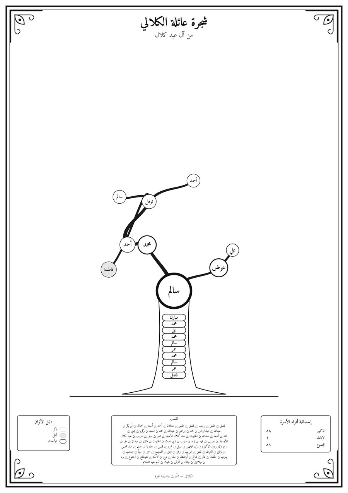

# شجرة · Shajarah — Family Tree Poster Generator

Enter a family (parents, children, spouses) and Shajarah grows it into an
ornamental, botanical nasab poster: the ancestral chain on the trunk, the
sons of the first branching ancestor as golden main limbs, and curved
tapered branches. **Every leaf is a person** with their name written on it:
green for sons, rose for daughters. Members with descendants sit at their
branch forks as generation-coloured tags. You can export it as
vector SVG or a high-DPI PDF/PNG for printing.

| Generated poster (demo data) | Al-Kalali lineage, black & white | Editor |
| --- | --- | --- |
|  |  |  |

## Stack

- **Next.js 14** (App Router, TypeScript) + **Tailwind CSS**
- **SVG** rendering, **d3-hierarchy** for the tree model, **d3-zoom** for pan/zoom
- **Prisma 5** + **PostgreSQL** for relational family data
- **jsPDF** for print PDF export · **Vitest** for layout tests

## Getting started

```bash
cd shajarah
npm install                    # also copies the Amiri fonts and generates the Prisma client
docker compose up -d           # PostgreSQL 16 on localhost:5432 (or use your own server)
cp .env.example .env           # adjust DATABASE_URL if needed
npm run db:migrate             # applies prisma/migrations
npm run db:seed                # optional: a 321-member sample family + the Al-Kalali lineage
npm run dev                    # http://localhost:3000
```

The page at **`/demo`** works without a database. It runs the same editor
with an in-memory repository. **`/demo?sample=kalali`** loads the Al-Kalali
lineage (85 generations, آدم → أحمد بن نوفل).

## Entering a family quickly: paste a nasab

Click **بن…** in the member list and paste one lineage per line, newest name
first:

```
أحمد بن نوفل بن أحمد بن محمد بن سالم … بن شيث بن آدم عليه السلام
فاطمة بنت نوفل بن أحمد بن محمد
```

- Each line becomes a chain of fathers. "بنت" marks the first person as a
  daughter. Text in parentheses, such as «يريم (ذو رعين الأكبر)», and
  honorifics like «عليه السلام» are stored as the laqab.
- Matching uses spelling-tolerant names (أ/إ/ا, ة/ه, «عبد الله»/«عبدالله»).
  People already in the tree are reused, and new ones are added below or
  above them. A line can start mid-tree. At least two consecutive names
  must agree before a line joins, so a lone «محمد» never links strangers.
- A preview shows how many names are reused and how many are new. It warns
  when a line fits in two places equally well.

## Choosing the trunk and canopy

Select anyone and press **🌳 Start the canopy here** (stored as
`FamilyTree.crownBaseId`). Everyone above them forms the trunk.

- **Trunk:** about the nearest 11 ancestors are written on the trunk. Older
  generations continue in an engraved **النسب** panel at the foot of the
  poster, so a chain back to آدم still fits.
- **Side branches:** brothers of trunk ancestors grow as side branches with
  their own small canopy. Brothers without descendants become short stubs.
- **Automatic mode:** without a choice, the canopy starts at the first real
  fork in the lineage.

## Styles

**🎨 Style** has four presets, and every setting can be overridden. Settings
are saved per tree in `settings.theme`.

| Preset | Look |
| --- | --- |
| Classic botanical | green leaves, generation-coloured forks, names carved in the bark |
| Silver & Gold | metallic silver (male) and gold (female) ovals, framed ancestor badges |
| Parchment & Emerald | emerald and gold leaves on parchment |
| Minimal black & white | white circles, fine line branches, like hand-drawn family charts |

Options:

- **Colours:** male, female, ancestor frame and branch colours, each with a
  colour picker.
- **Colour by:** gender or generation band.
- **Finish:** metallic gradients on or off.
- **Node shape:** leaves, circular badges or oval medallions.
- **Labels:** first name, or «name بن father», with optional
  birth/death years.
- **Trunk:** ancestors carved in the bark, or shown as framed badges.

| Script | What it does |
| --- | --- |
| `npm test` | Layout engine and genealogy-rule tests |
| `npm run typecheck` / `npm run lint` | Type and lint checks |
| `npm run db:studio` | Browse the data in Prisma Studio |

## Project structure

```
shajarah/
├── prisma/
│   ├── schema.prisma            FamilyTree · Member · Marriage
│   ├── migrations/              SQL migrations
│   └── seed.ts                  loads the sample family
├── src/
│   ├── app/
│   │   ├── page.tsx             tree list + "new tree" form
│   │   ├── trees/[treeId]/      editor backed by the database
│   │   ├── demo/                editor backed by memory (no DB)
│   │   └── api/                 REST routes (see below)
│   ├── components/
│   │   ├── editor/              TreeWorkspace, MemberForm, RelationsPanel, MemberPicker, repository
│   │   └── poster/              TreePoster (SVG), PosterViewport (d3-zoom), ExportMenu
│   └── lib/
│       ├── layout/              ← procedural layout engine (pure, framework-free)
│       │   ├── botanical.ts     hierarchy → trunk/crown → positions → branches/leaves
│       │   ├── geometry.ts      Bézier + tapered "ribbon" outlines
│       │   ├── palette.ts       generation colours (ألوان الأجيال)
│       │   └── random.ts        seeded PRNG
│       ├── export/exportPoster.ts  SVG / PNG / PDF export
│       ├── data/                Prisma client, tree service, HTTP helpers
│       ├── genealogy.ts         generations, cycle checks, nasab chain
│       ├── nasab.ts             nasab parser + matcher for "X بن Y" import
│       ├── theme.ts             style presets and colour helpers
│       ├── samples/kalali.ts    the Al-Kalali lineage
│       ├── validation.ts        zod schemas shared by API and UI
│       └── sampleData.ts        deterministic sample family
└── tests/                       layout, trunk/side-branch and nasab tests
```

## Data model

- **FamilyTree** owns members and marriages (cascade delete). It also stores
  the poster title and subtitle, the `lineage` (patrilineal or matrilineal),
  an optional explicit `rootMember`, the `crownBase` (where the canopy
  starts), and poster `settings` (JSON, including the theme).
- **Member** has `name`, `laqab`, `gender`, `birthYear`, `deathYear`,
  `isDeceased`, and `birthOrder` (sibling order on the poster). Parentage is
  two self-relations, `fatherId` and `motherId`, with `ON DELETE SET NULL`.
  `generation` is denormalised and indexed. The API recomputes it in a
  transaction whenever parentage changes.
- **Marriage** is a separate table, so a member can have several spouses,
  each with optional dates.

**Why there's no `isTrunkNode` column.** A member is on the trunk exactly
when they are an ancestor of the crown base. Storing that as a per-member
flag would need dozens of rows rewritten every time the crown base moves,
and any missed row would leave the flag silently wrong. Deriving it keeps
the data correct by construction.

The service layer (`src/lib/data/treeService.ts`) enforces the genealogy
rules:

- No loops (a member can't become their own ancestor).
- Fathers can't be female and mothers can't be male.
- Parents and spouses must belong to the same tree.
- No duplicate marriages.
- The first member added becomes the tree's root.

## REST API

Every mutation returns the full, updated tree, so the client never has to
reconcile partial state.

| Method | Route | Purpose |
| --- | --- | --- |
| GET / POST | `/api/trees` | list / create trees |
| GET / PATCH / DELETE | `/api/trees/:treeId` | read / update (title, lineage, root, settings) / delete |
| POST | `/api/trees/:treeId/members` | add a member (`spouseOfId` also creates a marriage) |
| PATCH / DELETE | `/api/members/:memberId` | edit / remove a member |
| POST | `/api/trees/:treeId/marriages` | link two spouses |
| DELETE | `/api/marriages/:marriageId` | unlink spouses |
| POST | `/api/trees/:treeId/import-nasab` | import pasted nasab lines (`{ text }`) in one transaction |

## The layout algorithm

`computePosterLayout(tree, { seed, showFemales })` is a pure function. The
same input and seed always produce the same poster.

1. **Hierarchy.** It builds the lineage tree (father-first or mother-first,
   depending on `lineage`) with d3-hierarchy and counts each subtree's
   leaves.
2. **Trunk and crown.** The trunk runs from the root to the crown base:
   the chosen `crownBaseId`, or else the first real fork. The crown base is
   the gold medallion at the top of the trunk.
   - The nearest ancestors are written on the trunk. Older ones flow into
     the النسب panel, and the poster switches to a taller base band to make
     room for it.
   - Brothers of trunk ancestors become stubs if childless, like غانم and
     قتيبع in the sample. Otherwise they become side branches: a small
     canopy fanning out from the trunk at their father's height.
3. **Partition.** Each crown node gets a slice of a 0–1 axis proportional to
   `leaves^0.8`. That axis maps to an angle around the crown base by the
   arc length of the crown outline (a superellipse), so the rim fills
   evenly. Sibling order is kept, so branches never cross. In RTL (Arabic)
   trees the eldest son sits on the right.
4. **Radius.** Distance from the crown base blends absolute generation depth
   with how much a branch still has to grow. Small families get a
   proportionally smaller crown.
5. **Collision relaxation.** Label boxes are pushed apart along their axis of
   least overlap. A uniform grid keeps each pass O(n), and springs pull
   tags back toward their targets. Trunk labels and stubs take part as
   fixed obstacles. The engine is tested to leave zero overlaps for every
   node shape.
6. **Branches.** Each edge is a cubic Bézier. Its start tangent continues the
   parent's growth direction and its end leans upward, which gives the
   "rise, then spread" silhouette. Width follows the pipe model
   (∝ √leaves) and is drawn as a filled, tapered outline rather than a
   stroke.
7. **Leaves are people.** Every childless crown member becomes a leaf
   pointing away from its parent on a thin stalk, with the name written
   along the blade and flipped so it always reads upright. Collision boxes
   use the rotated leaf's bounds. There are no decorative leaves, and
   generation colours avoid green so a tag is never mistaken for a leaf.
   **↻ Re-grow** changes the seed (branch jitter).

## Print export

- **SVG** is vector, with the Amiri fonts embedded as base64 and a physical
  size in mm. It opens unchanged in Illustrator, Inkscape or a print shop's
  software.
- **PDF / PNG** are rendered in the browser at the chosen A3–A0 size and
  150/200/300 DPI. Rendering in the browser guarantees correct Arabic letter
  joining, which many PDF text engines get wrong.
- **Font loading:** an SVG rendered as an image loads its fonts
  asynchronously, so a cold first export could paint invisible text. Before
  rendering, the exporter paints a small probe image and waits until all
  four Amiri faces have actually drawn.

For a fully vector PDF today, open the SVG in Inkscape and use "Save as PDF".

## Next steps

- Server-side vector PDF route (headless Chromium `page.pdf()`), plus
  CMYK/bleed options for print shops
- Hijri dates, and editable title, credits and sources panels like the
  reference posters
- Undo/redo, drag-to-reorder siblings, CSV/GEDCOM import
- Authentication and per-family sharing
